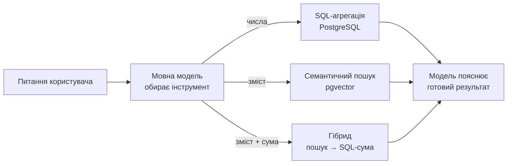

# Крона

**Кросплатформний застосунок для обліку особистих фінансів з AI-асистентом, який
відповідає на питання про ваші гроші звичайною мовою.**

Курсова робота на тему «Кросплатформний застосунок для обліку фінансів з гібридною
обробкою природномовних запитів на основі SQL та RAG».

Застосунок працює у браузері на комп'ютері та як мобільний застосунок на iOS і
Android. Обидва клієнти мають спільний бекенд і спільний шар логіки на TypeScript.

---

## Про що це

Звичайний облік витрат добре відповідає на питання «скільки я витратила на їжу у
вересні»: досить відфільтрувати записи й порахувати суму. Але люди питають і
інакше:

- «На що я витрачаю, коли нервую перед сесією?»
- «Скільки пішло на імпульсивні покупки через стрес?»
- «Що я купувала, коли була втомлена?»

Відповіді на такі питання немає в жодній колонці таблиці, вона схована в
нотатках до витрат. Крона поєднує два способи пошуку:

| Шлях | Коли | Як |
|---|---|---|
| **SQL** | питання про числа: суми, категорії, періоди | база даних рахує точно |
| **RAG** (семантичний пошук) | питання про зміст нотаток | нотатки й запит перетворюються на вектори, записи шукаються за схожістю змісту |
| **Гібрид** | сума для множини, заданої змістом | спершу пошук за змістом, потім база рахує суму знайденого |

Мовна модель лише **обирає** потрібний інструмент і **пояснює** результат. Самі
числа завжди рахує база даних. Модель не пише SQL і не займається арифметикою,
тому не може «вигадати» суму.



Окремий SQL-інструмент відповідає на питання про ліміти: скільки витрачено в
категорії, скільки лишилось і де ліміт перевищено. Ліміти лежать в окремій
таблиці, тому без нього модель їх просто не бачила.

Під відповіддю асистента показано записи, на яких вона побудована. Яким
інструментом її отримано, зберігається на сервері разом з повідомленням і
використовується в оцінці маршрутизації.

## Можливості

- Облік витрат і доходів: категорії, нотатки, дата, редагування, видалення з
  можливістю «Повернути»
- Введення своїми словами: «вчора таксі 230, бо проспала» заповнює форму
  (сума, категорія, дата, нотатка, настрій), а людина лише підтверджує. З
  ключем LLM розбирає модель, без нього — прості правила; знак суми й дату
  завжди рахує код
- Теги настрою: стрес, втома, свято, імпульс, з друзями, необхідне. Пошук і
  гібрид знаходять запис за тегом, названим у питанні, навіть без нотатки
- Підказка категорії за схожими власними записами, без мовної моделі
- Регулярні платежі: підписки, гуртожиток, проїзний — з датою наступного
  списання, на дашборді й у відповідях асистента («які в мене підписки?»)
- Попередження після витрати, якщо в категорії витрачено 80% ліміту або більше:
  на комп'ютері — повідомлення в застосунку, на телефоні — сповіщення
- Огляд місяця: залишок, доходи й витрати, порівняння з минулим місяцем
- Аналітика: структура витрат за категоріями, динаміка за рік
- Ліміти бюджету для категорій із попередженням про перевищення. Ліміти мають
  історію: зміна діє з поточного місяця, а минулі місяці звіряються з тим
  лімітом, що діяв тоді
- Пошук, фільтри й сортування операцій
- AI-асистент з історією розмови, спільною для комп'ютера й телефона
- Експорт у CSV (на комп'ютері) і «Поділитися» звітом за місяць (на телефоні)
- Акаунти: кожен бачить лише свої дані. Зміна пароля, вихід на всіх пристроях
  і видалення акаунта разом з усіма даними
- Захист входу: після 5 невдалих спроб за 15 хвилин вхід для цієї пари
  «email + адреса» тимчасово блокується

## Результати

Усе виміряно на сталих даних з репозиторію (див. «Оцінка асистента»), тож
цифри відтворюються. «Сьогодні» зафіксоване на 16 жовтня 2026.

**Маршрутизація, аргументи й достовірність** — 60 запитів, з них 23 з
очікуваними аргументами ([`cases.py`](backend/eval/cases.py),
[`models_comparison.csv`](backend/eval/models_comparison.csv)):

| Модель | Строга точність | М'яка точність | Аргументи вірні | Без вигаданих чисел | Час вибору (медіана) |
|---|---|---|---|---|---|
| **openai/gpt-oss-120b** (у застосунку) | **83.3%** (50/60) | **96.7%** (58/60) | **82.6%** (19/23) | 84.5% (49/58) | 1.1 с |
| openai/gpt-oss-20b | 78.3% (47/60) | 93.3% (56/60) | 73.9% (17/23) | — | 6.2 с |
| qwen/qwen3.8-27b | 80.0% (48/60) | 86.7% (52/60) | 60.9% (14/23) | — | 13.4 с |

- **Строга** точність зараховує лише найкращий шлях, **м'яка** — будь-який
  прийнятний. У 120b за типами: SQL 15/15, ліміти 5/5, «інструмент не
  потрібен» 12/12, пошук за змістом 11/14, гібрид 7/14. Слабке місце — гібрид:
  на «скільки я витратила на каву / таксі / Netflix» модель частіше бере SQL за
  категорією. Сума тоді правильна, але для всієї категорії, ширшої за запитане.
- **Без вигаданих чисел** — частка відповідей, де кожне число є в даних
  інструментів або в питанні ([`faithfulness.py`](backend/eval/faithfulness.py),
  відповіді — у [`results.csv`](backend/eval/results.csv)). У 9 з 58 відповідей
  120b таке число є: модель сама рахує «середнє за день» (≈176 ₴, 245 ₴) або
  вигадує приклади покупок («1 200 ₴ — супермаркет»), хоча промпт це прямо
  забороняє. Дві з дев'яти — загальні поради без даних («відкладайте 5%»).
  Отже, правило в промпті зменшує вигадки, але не прибирає їх, і перевірка
  потрібна. Повні відповіді рахувались лише для основної моделі, щоб не
  витрачати безкоштовну квоту.
- **Розкид між прогонами.** У прогоні з повними відповідями перший виклик тієї
  самої 120b дав строгу точність 76.7%, м'яку 91.7%, аргументи 69.6%, і двічі
  Groq відповів помилкою 400. `temperature 0` у провайдера не гарантує
  однакових відповідей, тож різницю в кілька пунктів між моделями не варто
  вважати значущою.
- **Час** включає чергу безкоштовного тарифу (8 000 токенів на хвилину на
  модель); 20b і qwen до того ж міркують перед відповіддю.

Для порівняння: на попередньому наборі з 30 запитів, на якому складався
промпт, і лише з м'якою метрикою було 30/30. Розширений набір із розмовними
запитами й строга метрика дають нижчі, але чесніші цифри.

**Підказка категорії** — leave-one-out на 177 записах фікстури
([`run_categories.py`](backend/eval/run_categories.py)): категорію кожного
запису вгадано за рештою записів.

| | усі підказки | коли згодні всі 5 сусідів |
|---|---|---|
| звичайний leave-one-out | 70.1% | 98.5% (на 38% записів) |
| без копій тієї самої нотатки | 36.2% | 88.0% (на 14% записів) |

Звичайний варіант завищує точність: та сама нотатка повторюється, і запис
знаходить власну копію. Другий рядок ближчий до нової, ще не баченої фрази.
Тому форма підставляє категорію сама лише тоді, коли згодні всі 5 сусідів, а
слабшу підказку тільки пропонує.

**Пошук за змістом** — 40 запитів із розміченими нотатками, порівну dev і test
([`run_retrieval.py`](backend/eval/run_retrieval.py)), macro-F1:

| | dev | test |
|---|---|---|
| вектор + бонус за слова (як у застосунку) | 0.35 | 0.57 |
| лише вектор | 0.33 | 0.40 |
| найкращий єдиний поріг на dev (0.60) | 0.46 | 0.59 |

Пороги в коді підбиралися на інших даних і тут не змінювались. На test
обраний поріг дає майже те саме, що й найкращий з dev, тож він не підігнаний
під розмітку. Але абсолютні цифри скромні: пошук пропускає записи, де той
самий зміст сказано іншими словами (див. «Обмеження»).

**Чому не досить одного шляху.** Той самий запит, проведений примусово через
кожен інструмент ([`backend/eval/run_baselines.py`](backend/eval/run_baselines.py)).

На робочих даних, де нотатки прямо кажуть «стрес»:

| Запит | Лише SQL | Лише RAG | Гібрид |
|---|---|---|---|
| «Скільки пішло на імпульсивні покупки через стрес?» | 16 719 ₴: уся категорія «покупки», зміст не врахований | 12 записів без суми | **6 111 ₴** по 12 записах |
| «Скільки всього я витратила у вересні?» | **9 871 ₴** | записи без суми | сума не за той період |

На сталій фікстурі, де той самий стрес описано іншими словами («перенервувала
перед колоквіумом», «щоб заспокоїтись»):

| Запит | Лише SQL | Лише RAG | Гібрид |
|---|---|---|---|
| «Скільки пішло на імпульсивні покупки через стрес?» | 7 368 ₴: уся категорія «покупки» | нічого не знайдено | 0 ₴ |
| «Скільки всього я витратила у вересні?» | **14 467 ₴** по 59 записах | нічого не знайдено | 0 ₴ |

SQL не розуміє змісту, RAG не вміє рахувати, і кожен шлях добрий у своїх
питаннях, тому модель обирає між ними. Друга таблиця показує межу методу:
гібрид рахує правильно лише те, що знайшов пошук, а невелика локальна модель
ембедингів не пов'язує «стрес» з «перенервувала». Сума тоді не вигадана, а
порожня, і це видно у відповіді.

## Технології

| Частина | Стек |
|---|---|
| Бекенд | Python 3.13, FastAPI, SQLAlchemy (async), Alembic |
| База даних | PostgreSQL 16 + pgvector (у Docker) |
| Ембединги | fastembed, багатомовна `paraphrase-multilingual-MiniLM-L12-v2` (локально, без зовнішніх сервісів) |
| Мовна модель | Groq API, function calling (OpenAI-сумісний інтерфейс) |
| Комп'ютер | React 19, Vite, Tailwind CSS, Radix UI, Recharts |
| Телефон | React Native, Expo SDK 58 (запуск через Expo Go), expo-notifications |
| Спільний шар | TypeScript-пакет `@finance/shared`: типи, API-клієнт, константи |
| Тести | pytest (169 тестів на окремій тестовій базі) |

## Структура репозиторію

```
finance-ai-tracker/
├── backend/                 FastAPI-сервер
│   ├── app/
│   │   ├── routers/         ендпоінти: транзакції, статистика, ліміти, чат, акаунти
│   │   ├── tools.py         інструменти, між якими обирає модель
│   │   ├── search.py        семантичний пошук (RAG)
│   │   ├── embeddings.py    модель ембедингів і пороги релевантності
│   │   └── llm.py           звернення до мовної моделі
│   ├── migrations/          схема БД (Alembic)
│   ├── eval/                оцінка точності маршрутизації
│   └── tests/               тести
└── frontend/
    ├── shared/              спільний TypeScript-шар
    ├── desktop/             веб-клієнт для комп'ютера
    └── mobile/              мобільний клієнт (Expo)
```

---

## Як запустити

### Що потрібно

- [Docker Desktop](https://www.docker.com/products/docker-desktop/) для бази даних
- [Python 3.13](https://www.python.org/downloads/)
- [Node.js 20+](https://nodejs.org/)
- *(необов'язково)* ключ [Groq API](https://console.groq.com/keys). Він безкоштовний.
  Без нього все працює, крім AI-асистента.
- *(для телефона)* застосунок **Expo Go** з App Store або Google Play. Проєкт на
  Expo SDK 58, тож потрібна актуальна версія Expo Go

### 1. Завантажити код

```bash
git clone https://github.com/Roksolaana/finance-ai-tracker.git
cd finance-ai-tracker
```

### 2. Налаштування

```bash
cd backend
cp .env.example .env
```

У `.env` за потреби вставте `GROQ_API_KEY`. Решту можна не чіпати: ключ для
токенів входу застосунок згенерує й допише сам при першому запуску.

### 3. База даних

Docker Desktop має бути запущений.

```bash
docker compose up -d
```

### 4. Бекенд

```bash
python -m venv .venv

# Windows (PowerShell)
.venv\Scripts\activate
# Windows (Git Bash)
source .venv/Scripts/activate
# macOS / Linux
source .venv/bin/activate

pip install -r requirements.txt
```

### 5. Фронтенд

З кореня репозиторію (одна команда встановлює залежності для всіх трьох
фронтенд-пакетів):

```bash
cd ..
npm install
cd frontend/desktop
npm run build
```

### 6. Запуск

```bash
cd ../../backend
uvicorn app.main:app --host 0.0.0.0 --reload
```

Відкрийте **http://localhost:8000** і зареєструйтеся. Сервер віддає і API, і
зібраний веб-клієнт на одному порту. Таблиці в базі він створює сам при старті.

> Перший запуск триває довше: один раз завантажується модель ембедингів (~220 МБ).

Корисні адреси:
- http://localhost:8000/docs — інтерактивна документація API (Swagger)
- http://localhost:8000/health — перевірка, що сервер і база працюють

### Мобільний застосунок

Бекенд має працювати з `--host 0.0.0.0`, як у кроці 6: так його бачать інші
пристрої в мережі. Телефон і комп'ютер мають бути в одній Wi-Fi мережі.

```bash
cd frontend/mobile
npx expo start --lan
```

Відскануйте QR-код камерою (iPhone) або в Expo Go (Android). Застосунок сам знайде
адресу сервера.

Якщо телефон не підключається, відкрийте на ньому в браузері
`http://<IP комп'ютера>:8000/health`. Має з'явитися `{"status":"ok",...}`. Якщо ні,
перешкода в мережі: брандмауер або Wi-Fi, що ізолює пристрої (часто так у
публічних мережах). Тоді можна роздати інтернет з телефона й підключити до нього
комп'ютер.

### Режим розробки інтерфейсу

Для роботи над веб-клієнтом з миттєвим оновленням замість `npm run build`:

```bash
cd frontend/desktop
npm run dev
```

Інтерфейс відкриється на http://localhost:5173, запити до API підуть на бекенд
на порту 8000.

---

## Тести

Тести створюють окрему базу `finance_test` у тому ж контейнері й видаляють її в
кінці, тож ваші дані не зачіпаються. Docker має працювати.

```bash
cd backend
pip install -r requirements-dev.txt
python -m pytest
```

Що перевіряється:
- межі місяця за київським часом
- перевірка введених даних
- ізоляція акаунтів
- ліміти бюджету, зокрема інструмент асистента для них та історія лімітів
  (зміна в жовтні не переписує вересень)
- статистика
- історія чату
- пошук, зокрема фільтр за періодом у пошуку за змістом
- гібрид: сума й кількість рахуються по всіх знайдених записах, а не лише по
  показаних
- порівняння періодів
- міграції: перенесення наявних лімітів в історію, зупинка міграції на записах
  без власника
- безпека акаунта: блокування підбору пароля, відкликання токенів після зміни
  пароля чи виходу на всіх пристроях, видалення акаунта з усіма даними
- оцінка асистента без виклику моделі: зафіксоване «сьогодні» доходить і до
  промпту, і до інструментів; набір запитів збалансований і узгоджений зі
  схемами інструментів; фікстура відтворюється генератором і завантажується в
  базу; метрики пошуку й маршрутизації рахуються правильно
- перевірка чисел у відповіді (faithfulness) на синтетичних прикладах: формати
  сум, відсотки, дати й нумерація, округлення, числа з питання
- введення своїми словами: 18 фраз для простого розбору, знак і дата від коду
  при розборі моделлю, запасний розбір, коли модель недоступна чи відповіла не
  за схемою
- теги: збереження, перевірка, пошук і гібрид за тегом без нотатки
- підказка категорії: голосування сусідів, лише власні записи, замало історії
- регулярні платежі: щомісячні серії, відсіювання щоденних покупок, стрибків
  суми й доходів, інструмент асистента
- попередження про ліміт: поріг 80%, перевищення, місяць самої витрати
- поведінка при недоступній базі

## Оцінка асистента

Усі скрипти працюють на сталих даних з [`backend/eval/fixture.json`](backend/eval/fixture.json)
(177 синтетичних операцій, 75 різних нотаток, ліміти з історією), які самі
завантажують в окрему базу `finance_eval`. Робоча база не потрібна й не
чіпається, тож результат відтворюється на будь-якому комп'ютері.

**Маршрутизація й аргументи.** 60 запитів у [`backend/eval/cases.py`](backend/eval/cases.py),
зокрема розмовні, із суржиком і помилками в словах. Кожен має один найкращий
шлях (`primary`) і перелік прийнятних, а також очікувані аргументи. «Сьогодні»
зафіксоване на 16 жовтня 2026 і для промпту, і для інструментів, тож «минулий
місяць» завжди означає вересень.

```bash
cd backend
# лише вибір інструмента: один запит до моделі на кейс (~60 запитів)
python -m eval.run_routing --compare
# повні відповіді й перевірка чисел: два запити на кейс (~120 запитів)
python -m eval.run_routing --answers --compare --csv eval/results.csv
# інша модель того самого провайдера
python -m eval.run_routing --compare --model openai/gpt-oss-20b
```

Безкоштовний тариф Groq дає 8 000 токенів на хвилину, тож прогін триває
20–60 хвилин: після відмови через ліміт скрипт чекає й продовжує. Готові
кейси зберігаються в `backend/eval/runs/`, і перерваний прогін продовжується
тією самою командою. Зведення моделей — у [`backend/eval/models_comparison.csv`](backend/eval/models_comparison.csv).

**Достовірність відповіді.** [`backend/eval/faithfulness.py`](backend/eval/faithfulness.py)
витягує з відповіді всі числа (формати «1 234 ₴», «1 234,50», відсотки, «16 тис.»)
і перевіряє, що кожне є в даних, які повернули інструменти, або в самому питанні.
Дати, дні місяця, роки й нумерація рядків не перевіряються. Округлення до гривні
не вважається вигадкою, а сума, яку модель склала сама, вважається.

**Пошук.** 40 запитів з розміченими релевантними нотатками в
[`backend/eval/retrieval_cases.py`](backend/eval/retrieval_cases.py), поділені навпіл
на dev і test. Мовна модель не потрібна, лише локальна модель ембедингів.

```bash
python -m eval.run_retrieval
```

Скрипт рахує precision, recall і F1 окремо для dev і test, будує таблицю
«поріг → F1» на dev і порівнює «лише вектор» з «вектор + бонус за слова».
Пороги в коді він не змінює.

**Чому не досить одного шляху.** Той самий запит примусово через кожен
інструмент. Мовну модель скрипт не викликає:

```bash
python -m eval.run_baselines
```

## Схема бази даних

Схема описана міграціями Alembic у `backend/migrations/versions/`. Сервер
доводить базу до останньої версії сам при старті. Якщо міграція не вдалась,
сервер не запуститься, щоб не працювати зі зламаною схемою.

Застосувати вручну:

```bash
cd backend
python -c "from app.migrate import upgrade_to_head; upgrade_to_head()"
```

---

## Обмеження

- **Семантичний пошук упевнено працює на конкретних запитах** («кава з собою» —
  схожість 0.75), але слабшає на абстрактних («навчання» — 0.33). Це властивість
  невеликої багатомовної моделі, яка працює локально. Щоб не губити записи, де
  потрібне слово стоїть прямо в нотатці, до схожості змісту додається бонус за
  збіг слів. Цей компроміс задокументовано в `backend/app/embeddings.py`.
- **Асистент працює лише з ключем Groq**, тобто з інтернетом. Решта застосунку
  працює й без нього.
- **Статистика групується за київським часом** (`APP_TIMEZONE` у `.env`).
- **Перелік під відповіддю гібрида обмежений 50 записами.** Сума й кількість
  рахуються по всіх знайдених, а якщо показано менше, відповідь інструмента
  містить позначку `truncated`, і модель не видає перелік за повний.
- **Історія лімітів починається з моменту оновлення.** Для лімітів, заданих до
  неї, відома лише остання зміна, тож вони вважаються чинними з місяця цієї
  зміни, а раніше лімітів немає.
- **Лічильники спроб входу й запитів до асистента живуть у пам'яті процесу.**
  Після перезапуску сервера вони обнуляються, а при запуску кількох процесів
  кожен рахуватиме окремо.
- **Пошук за змістом слабшає, коли нотатка каже те саме іншими словами.**
  На сталих даних F1 пошуку — 0.35 на dev і 0.57 на test
  ([`backend/eval/run_retrieval.py`](backend/eval/run_retrieval.py)). Запит «витрати
  через стрес» не знаходить «Шоколад і чипси, бо перенервувала перед
  колоквіумом»: бонус за слова допомагає, лише коли слово з запиту стоїть у
  нотатці. Бонус підвищує F1 з 0.33 до 0.35 на dev і з 0.40 до 0.57 на test.
- **Короткі нотатки з одного слова «схожі на все».** «Стипендія» потрапляє в
  зайві збіги майже на кожен запит: вектор одного слова лягає в загальну зону,
  так само як вектор однослівного запиту.
- **Обраний поріг 0.50 не найкращий на dev.** Єдиний поріг 0.60 дає вищий F1 на
  dev (0.46) і майже той самий на test (0.59 проти 0.57). Пороги в коді не
  змінювались, щоб не підганяти їх під розмітку; на 20 запитах на частину
  розкид великий, і різниця між dev і test це показує.
- **Підказка категорії слабка на нових фразах.** Без копій тієї самої нотатки
  вона вгадує лише 36% записів; сама форма підставляє її тільки при одностайних
  сусідах (88%, але це лише 14% записів).
- **Регулярний платіж шукається за однаковою нотаткою або категорією.**
  Перейменована нотатка чи пропущений місяць розривають серію, а наступне
  списання очікується того самого числа наступного місяця.
- **Інструмент `find_recurring` з'явився після оцінки маршрутизації** і в
  наборі запитів його немає; його покривають лише тести.
- **Простий розбір фрази бере перше число як суму:** у «кава о 8 ранку 85»
  сумою стане 8. Чернетку людина бачить у формі й виправляє, а розбір моделлю
  такої помилки не робить. Кожен розбір моделлю — один запит до LLM; понад
  30 за 10 хвилин на користувача розбирають правила.
- **Сповіщення на телефоні потребують дозволу.** Без нього, або якщо Expo Go
  їх не показує, попередження про ліміт з'являється в самому застосунку.
- **Faithfulness перевіряє лише числа, записані цифрами.** Невірну категорію чи
  хибний висновок словами він не помітить, а розбіжність менше гривні
  вважає округленням.
- **Міграція 0007 зупиняється, якщо в базі є транзакції без власника.** Такі
  записи могли лишитися з версій до появи акаунтів. Міграція їх не видаляє:
  потрібно призначити їм власника або видалити вручну, текст помилки підказує
  як.
