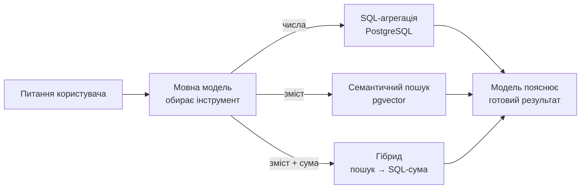

# Крона

**Кросплатформний застосунок для обліку особистих фінансів з AI-асистентом, який
відповідає на питання про ваші гроші звичайною мовою.**

Курсова робота на тему «Кросплатформний застосунок для обліку фінансів з гібридною
обробкою природномовних запитів на основі SQL та RAG».

Застосунок працює у браузері на комп'ютері та як мобільний застосунок на iOS і
Android. Обидва клієнти мають спільний бекенд і спільний шар логіки на TypeScript.

---

## Про що це

Звичайний облік витрат добре відповідає на питання «скільки я витратила на їжу у
вересні»: досить відфільтрувати записи й порахувати суму. Але люди питають і
інакше:

- «На що я витрачаю, коли нервую перед сесією?»
- «Скільки пішло на імпульсивні покупки через стрес?»
- «Що я купувала, коли була втомлена?»

Відповіді на такі питання немає в жодній колонці таблиці, вона схована в
нотатках до витрат. Крона поєднує два способи пошуку:

| Шлях | Коли | Як |
|---|---|---|
| **SQL** | питання про числа: суми, категорії, періоди | база даних рахує точно |
| **RAG** (семантичний пошук) | питання про зміст нотаток | нотатки й запит перетворюються на вектори, записи шукаються за схожістю змісту |
| **Гібрид** | сума для множини, заданої змістом | спершу пошук за змістом, потім база рахує суму знайденого |

Мовна модель лише **обирає** потрібний інструмент і **пояснює** результат. Самі
числа завжди рахує база даних. Модель не пише SQL і не займається арифметикою,
тому не може «вигадати» суму.



Під кожною відповіддю асистента є кнопка **ⓘ**. Вона показує, яким шляхом
отримано відповідь, скільки це тривало й на яких записах вона побудована.

## Можливості

- Облік витрат і доходів: категорії, нотатки, дата, редагування, видалення з
  можливістю «Повернути»
- Огляд місяця: залишок, доходи й витрати, порівняння з минулим місяцем
- Аналітика: структура витрат за категоріями, динаміка за рік
- Ліміти бюджету для категорій із попередженням про перевищення
- Пошук, фільтри й сортування операцій
- AI-асистент з історією розмови, спільною для комп'ютера й телефона
- Експорт у CSV (на комп'ютері) і «Поділитися» звітом за місяць (на телефоні)
- Акаунти: кожен бачить лише свої дані

## Результати

**Точність вибору інструмента: 30 / 30.** На наборі з 30 запитів різних типів
(числові, змістові, змішані, такі, що не потребують даних) модель щоразу обрала
правильний шлях. Набір запитів лежить у [`backend/eval/cases.py`](backend/eval/cases.py),
результати в [`backend/eval/results.csv`](backend/eval/results.csv).

**Чому не досить одного шляху.** Той самий запит, проведений примусово через
кожен інструмент ([`backend/eval/run_baselines.py`](backend/eval/run_baselines.py)):

| Запит | Лише SQL | Лише RAG | Гібрид |
|---|---|---|---|
| «Скільки пішло на імпульсивні покупки через стрес?» | 16 719 ₴: уся категорія «покупки», зміст не врахований | 12 записів без суми | **6 111 ₴** по 12 записах |
| «Скільки всього я витратила у вересні?» | **9 871 ₴** | записи без суми | сума не за той період |

SQL не розуміє змісту, RAG не вміє рахувати, і кожен шлях добрий у своїх питаннях.
Тому модель обирає між ними.

## Технології

| Частина | Стек |
|---|---|
| Бекенд | Python 3.13, FastAPI, SQLAlchemy (async), Alembic |
| База даних | PostgreSQL 16 + pgvector (у Docker) |
| Ембединги | fastembed, багатомовна `paraphrase-multilingual-MiniLM-L12-v2` (локально, без зовнішніх сервісів) |
| Мовна модель | Groq API, function calling (OpenAI-сумісний інтерфейс) |
| Комп'ютер | React 19, Vite, Tailwind CSS, Radix UI, Recharts |
| Телефон | React Native, Expo (запуск через Expo Go) |
| Спільний шар | TypeScript-пакет `@finance/shared`: типи, API-клієнт, константи |
| Тести | pytest (62 тести на окремій тестовій базі) |

## Структура репозиторію

```
finance-ai-tracker/
├── backend/                 FastAPI-сервер
│   ├── app/
│   │   ├── routers/         ендпоінти: транзакції, статистика, ліміти, чат, акаунти
│   │   ├── tools.py         інструменти, між якими обирає модель
│   │   ├── search.py        семантичний пошук (RAG)
│   │   ├── embeddings.py    модель ембедингів і пороги релевантності
│   │   └── llm.py           звернення до мовної моделі
│   ├── migrations/          схема БД (Alembic)
│   ├── eval/                оцінка точності маршрутизації
│   └── tests/               тести
└── frontend/
    ├── shared/              спільний TypeScript-шар
    ├── desktop/             веб-клієнт для комп'ютера
    └── mobile/              мобільний клієнт (Expo)
```

---

## Як запустити

### Що потрібно

- [Docker Desktop](https://www.docker.com/products/docker-desktop/) для бази даних
- [Python 3.13](https://www.python.org/downloads/)
- [Node.js 20+](https://nodejs.org/)
- *(необов'язково)* ключ [Groq API](https://console.groq.com/keys). Він безкоштовний.
  Без нього все працює, крім AI-асистента.
- *(для телефона)* застосунок **Expo Go** з App Store або Google Play

### 1. Завантажити код

```bash
git clone https://github.com/Roksolaana/finance-ai-tracker.git
cd finance-ai-tracker
```

### 2. Налаштування

```bash
cd backend
cp .env.example .env
```

У `.env` за потреби вставте `GROQ_API_KEY`. Решту можна не чіпати: ключ для
токенів входу застосунок згенерує й допише сам при першому запуску.

### 3. База даних

Docker Desktop має бути запущений.

```bash
docker compose up -d
```

### 4. Бекенд

```bash
python -m venv .venv

# Windows (PowerShell)
.venv\Scripts\activate
# macOS / Linux
source .venv/bin/activate

pip install -r requirements.txt
```

### 5. Фронтенд

З кореня репозиторію (одна команда встановлює залежності для всіх трьох
фронтенд-пакетів):

```bash
cd ..
npm install
cd frontend/desktop
npm run build
```

### 6. Запуск

```bash
cd ../../backend
uvicorn app.main:app --host 0.0.0.0 --reload
```

Відкрийте **http://localhost:8000** і зареєструйтеся. Сервер віддає і API, і
зібраний веб-клієнт на одному порту. Таблиці в базі він створює сам при старті.

> Перший запуск триває довше: один раз завантажується модель ембедингів (~220 МБ).

Корисні адреси:
- http://localhost:8000/docs — інтерактивна документація API (Swagger)
- http://localhost:8000/health — перевірка, що сервер і база працюють

### Мобільний застосунок

Бекенд має працювати з `--host 0.0.0.0`, як у кроці 6: так його бачать інші
пристрої в мережі. Телефон і комп'ютер мають бути в одній Wi-Fi мережі.

```bash
cd frontend/mobile
npx expo start --lan
```

Відскануйте QR-код камерою (iPhone) або в Expo Go (Android). Застосунок сам знайде
адресу сервера.

Якщо телефон не підключається, відкрийте на ньому в браузері
`http://<IP комп'ютера>:8000/health`. Має з'явитися `{"status":"ok",...}`. Якщо ні,
перешкода в мережі: брандмауер або Wi-Fi, що ізолює пристрої (часто так у
публічних мережах). Тоді можна роздати інтернет з телефона й підключити до нього
комп'ютер.

### Режим розробки інтерфейсу

Для роботи над веб-клієнтом з миттєвим оновленням замість `npm run build`:

```bash
cd frontend/desktop
npm run dev
```

Інтерфейс відкриється на http://localhost:5173, запити до API підуть на бекенд
на порту 8000.

---

## Тести

Тести створюють окрему базу `finance_test` у тому ж контейнері й видаляють її в
кінці, тож ваші дані не зачіпаються. Docker має працювати.

```bash
cd backend
pip install -r requirements-dev.txt
python -m pytest
```

Що перевіряється:
- межі місяця за київським часом
- перевірка введених даних
- ізоляція акаунтів
- ліміти бюджету
- статистика
- історія чату
- пошук
- порівняння періодів
- поведінка при недоступній базі

## Оцінка асистента

Точність вибору інструмента на 30 запитах. Потрібен `GROQ_API_KEY`; прогін
коштує близько 30 запитів до моделі.

```bash
cd backend
python -m eval.run_routing --csv eval/results.csv
```

Порівняння шляхів на тих самих запитах. Цей скрипт мовну модель не викликає:

```bash
python -m eval.run_baselines
```

## Схема бази даних

Схема описана міграціями Alembic у `backend/migrations/versions/`. Сервер
доводить базу до останньої версії сам при старті. Якщо міграція не вдалась,
сервер не запуститься, щоб не працювати зі зламаною схемою.

Застосувати вручну:

```bash
cd backend
python -c "from app.migrate import upgrade_to_head; upgrade_to_head()"
```

---

## Обмеження

- **Семантичний пошук упевнено працює на конкретних запитах** («кава з собою» —
  схожість 0.75), але слабшає на абстрактних («навчання» — 0.33). Це властивість
  невеликої багатомовної моделі, яка працює локально. Щоб не губити записи, де
  потрібне слово стоїть прямо в нотатці, до схожості змісту додається бонус за
  збіг слів. Цей компроміс задокументовано в `backend/app/embeddings.py`.
- **Асистент працює лише з ключем Groq**, тобто з інтернетом. Решта застосунку
  працює й без нього.
- **Статистика групується за київським часом** (`APP_TIMEZONE` у `.env`).
